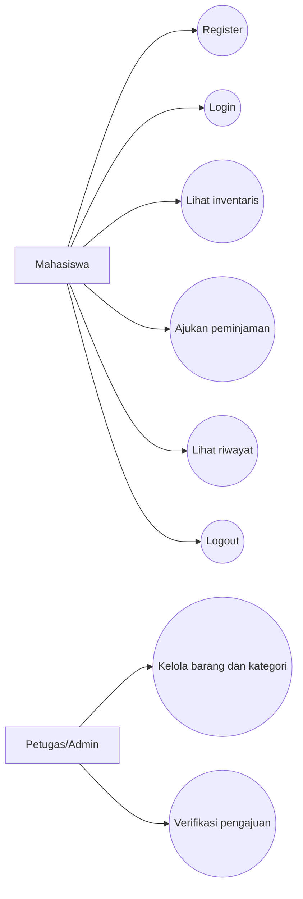
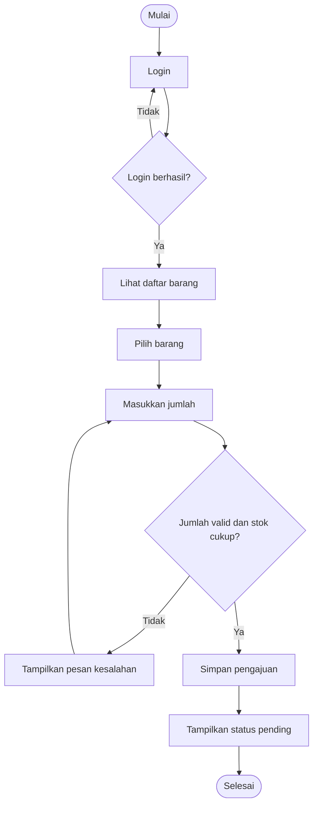
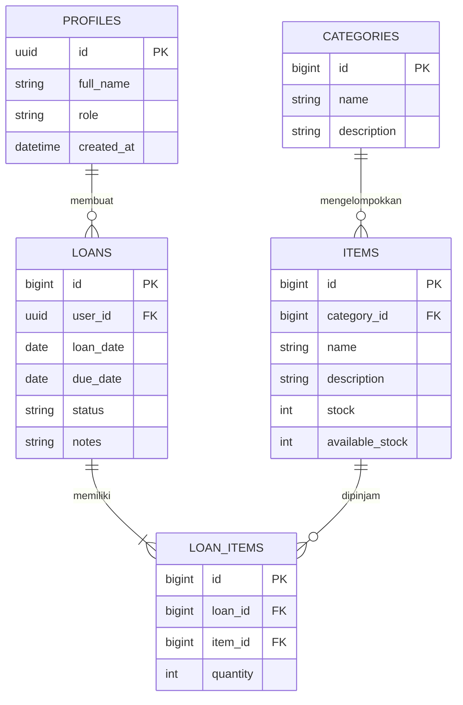
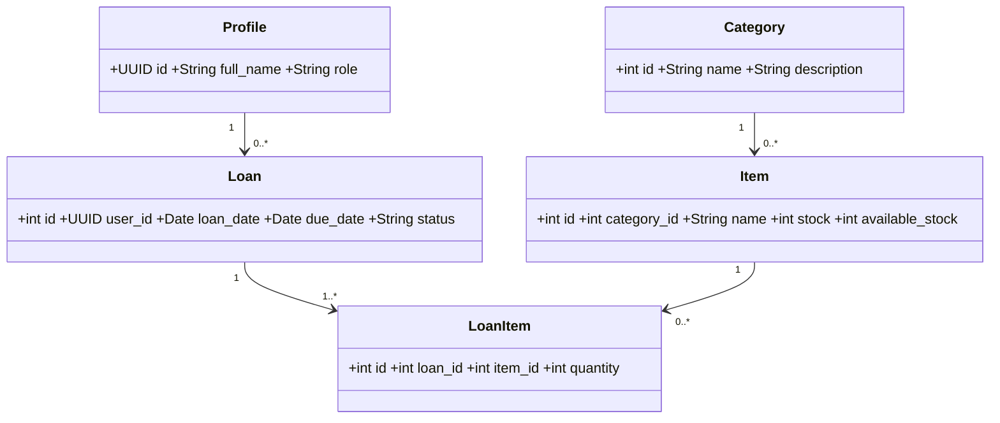
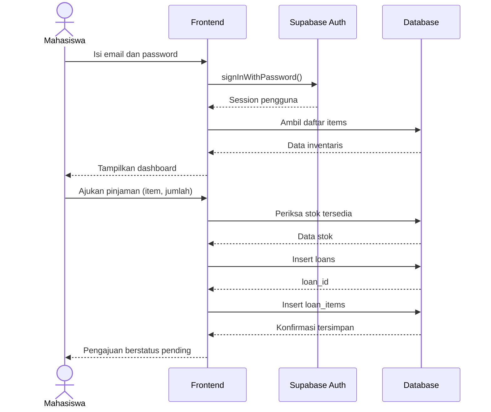

# Dokumentasi SIPINJAM

## 1. Definisi aplikasi (SRS)
SIPINJAM adalah aplikasi web sederhana untuk membantu mahasiswa mengajukan peminjaman barang inventaris kampus. Pengguna dapat membuat akun, login, melihat barang dan stok, mengajukan jumlah pinjaman, serta melihat status dan riwayat pengajuan.

### Aktor
- Mahasiswa/peminjam: register, login, melihat inventaris, mengajukan peminjaman, melihat riwayat.
- Petugas/admin: pada pengembangan lanjutan, memverifikasi pengajuan, mengelola barang, kategori, dan pengembalian.

### Kebutuhan fungsional
1. Sistem menyediakan register menggunakan nama, email, dan password.
2. Sistem menyediakan login dan logout.
3. Pengguna yang login dapat melihat daftar barang, kategori, dan stok.
4. Pengguna dapat mengajukan peminjaman satu jenis barang dengan jumlah tertentu.
5. Sistem memvalidasi jumlah pinjaman terhadap stok tersedia.
6. Pengguna dapat melihat daftar pengajuannya beserta status.

### Kebutuhan nonfungsional
- Aplikasi berjalan di browser modern dan membutuhkan koneksi internet.
- Password dikelola oleh Supabase Auth, bukan disimpan sebagai teks biasa di tabel aplikasi.
- Akses data dibatasi menggunakan Row Level Security (RLS).
- Tampilan responsif untuk desktop dan ponsel.

### Batasan prototype
Prototype ini fokus pada autentikasi, melihat inventaris, membuat pengajuan, dan melihat riwayat. Persetujuan admin, pengurangan stok otomatis, dan pencatatan pengembalian belum diimplementasikan pada antarmuka.

## 2. Use Case Diagram


## 3. Use Case Scenario — Ajukan peminjaman
- **Aktor:** Mahasiswa
- **Tujuan:** Mengajukan peminjaman barang.
- **Prasyarat:** Pengguna sudah login dan barang tersedia.
- **Alur utama:**
  1. Pengguna membuka dashboard.
  2. Sistem menampilkan inventaris dan stok.
  3. Pengguna menekan tombol Ajukan pinjam.
  4. Pengguna memasukkan jumlah.
  5. Sistem memeriksa jumlah terhadap stok tersedia.
  6. Sistem menyimpan data pengajuan dan detail barang.
  7. Sistem menampilkan pesan bahwa pengajuan berstatus pending.
- **Alur alternatif:** Jika jumlah tidak valid atau melebihi stok, sistem menampilkan pesan kesalahan dan tidak menyimpan detail pengajuan.
- **Kondisi akhir:** Data pengajuan tersimpan dengan status `pending`.

## 4. Activity Diagram


## 5. Entity Relationship Diagram (ERD)


### Penjelasan relasi
- Satu profile dapat membuat banyak loan (1:M).
- Satu category dapat memiliki banyak item (1:M).
- Satu loan memiliki satu atau lebih loan_items (1:M).
- Satu item dapat muncul pada banyak loan_items (1:M).
- Dengan tabel penghubung `loan_items`, relasi loan dan item menjadi many-to-many.

## 6. Class Diagram


## 7. Sequence Diagram


## 8. SDD — rancangan pengembangan
- **Frontend:** HTML, CSS, JavaScript.
- **Backend-as-a-Service:** Supabase Auth dan Supabase Database (PostgreSQL) menyediakan autentikasi dan API database.
- **Alur register:** Browser mengirim nama, email, password ke Supabase Auth. Trigger database membuat baris `profiles`.
- **Alur login:** Supabase Auth memvalidasi kredensial dan mengembalikan session.
- **Alur pengajuan:** Frontend memeriksa stok, membuat baris `loans`, lalu membuat `loan_items`.
- **Keamanan:** Frontend menggunakan anon/public key Supabase; RLS membatasi data. Jangan pernah menaruh `service_role` key di frontend.

## 9. UAT — rencana pengujian
| ID | Skenario | Langkah | Hasil yang diharapkan |
|---|---|---|---|
| UAT-01 | Register valid | Isi nama, email baru, password >= 6 karakter | Akun berhasil dibuat / diminta konfirmasi email |
| UAT-02 | Register email terpakai | Daftar memakai email yang sudah terdaftar | Sistem menampilkan pesan kesalahan |
| UAT-03 | Login valid | Masukkan email dan password benar | Dashboard tampil |
| UAT-04 | Login salah | Masukkan password salah | Pesan kesalahan tampil |
| UAT-05 | Lihat inventaris | Login dan buka dashboard | Daftar barang dan stok tampil |
| UAT-06 | Ajukan jumlah valid | Ajukan barang dengan jumlah <= stok | Pengajuan tersimpan dengan status pending |
| UAT-07 | Jumlah melebihi stok | Masukkan jumlah > stok | Sistem menolak pengajuan |
| UAT-08 | Riwayat | Buka bagian riwayat | Pengajuan milik akun tampil |
| UAT-09 | Logout | Tekan tombol keluar | Kembali ke halaman login |

**Template hasil UAT:** Tanggal: ____; Penguji: ____; Browser/perangkat: ____.
Status tiap kasus: Pass / Fail; Bukti screenshot: ____; Catatan/bug: ____.
Catatan: tabel ini adalah rencana kasus uji. Isi hasil Pass/Fail hanya setelah benar-benar menjalankan pengujian.

## 10. Analisis data database
Contoh pertanyaan analisis yang dapat dibuat setelah data uji masuk:
1. Berapa jumlah barang pada setiap kategori?
2. Barang apa yang memiliki stok tersedia paling sedikit?
3. Berapa jumlah pengajuan berdasarkan status (pending/approved/rejected/returned)?
4. Berapa total unit barang yang diajukan?
5. Siapa pengguna dengan jumlah pengajuan terbanyak?

Contoh SQL:
```sql
-- Jumlah barang per kategori
select c.name, count(i.id) as jumlah_jenis_barang,
       coalesce(sum(i.stock),0) as total_stok
from categories c left join items i on i.category_id=c.id
group by c.id,c.name order by c.name;

-- Jumlah pengajuan per status
select status, count(*) as jumlah_pengajuan
from loans group by status order by status;

-- Barang paling sedikit stok tersedia
select name, available_stock
from items order by available_stock asc, name limit 5;

-- Total unit yang diajukan per barang
select i.name, sum(li.quantity) as total_diajukan
from loan_items li join items i on i.id=li.item_id
group by i.id,i.name order by total_diajukan desc;
```

## 11. Catatan pengembangan selanjutnya
Untuk versi yang lebih lengkap, buat halaman admin untuk menambah/mengubah barang, mengelola kategori, menyetujui/menolak pinjaman, mencatat pengembalian, dan memperbarui stok secara transaksional. Tambahkan juga validasi tanggal pinjam/kembali dan log aktivitas.
